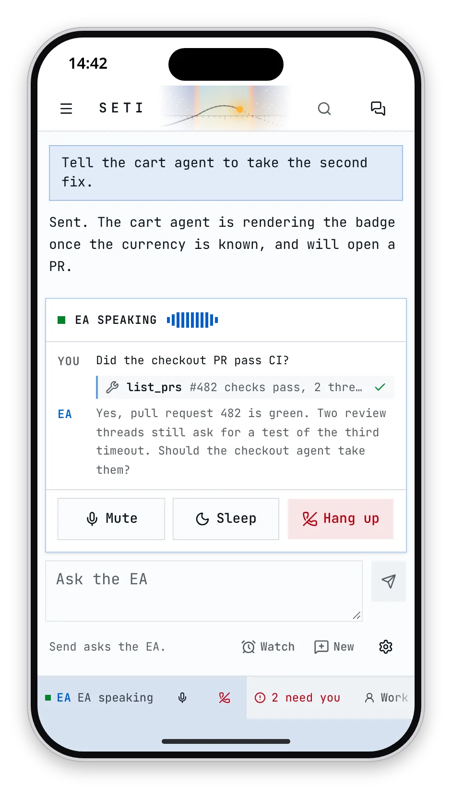
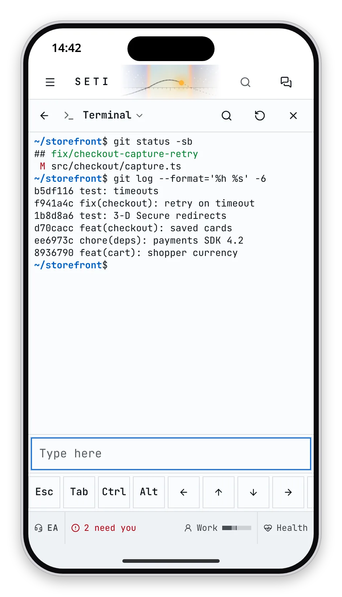
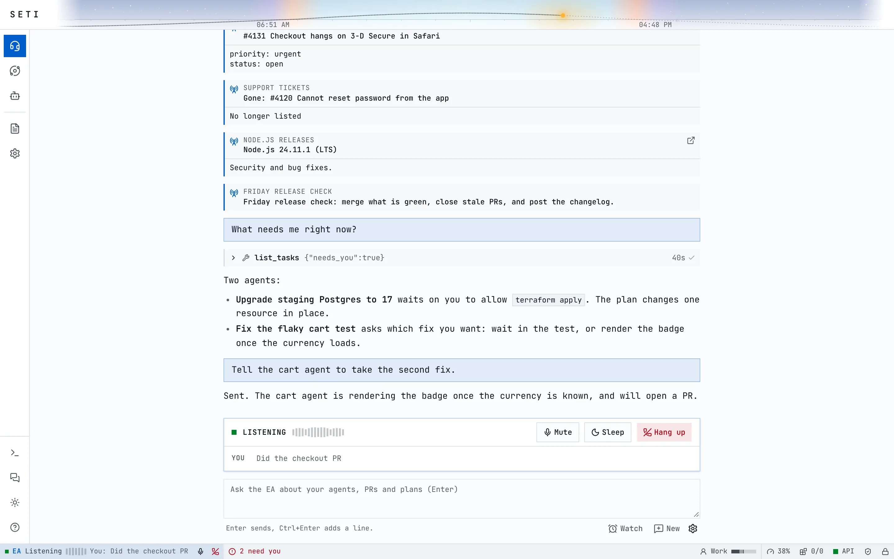

<p align="center">
  <picture>
    <source media="(prefers-color-scheme: dark)" srcset="docs/banner-dark.svg">
    <source media="(prefers-color-scheme: light)" srcset="docs/banner-light.svg">
    
  </picture>
</p>

<p align="center"><b>Control a swarm of coding agents by voice, from any browser.</b></p>

<p align="center">
  <a href="https://rickaym.dev/seti/">Website</a> &middot;
  <a href="docs/setup.md">Setup</a> &middot;
  <a href="docs/security.md">Security</a> &middot;
  <a href="docs/mods.md">Mods</a> &middot;
  <a href="CONTRIBUTING.md">Contributing</a>
</p>

<p align="center">
  <a href="https://github.com/rickaym/seti/actions/workflows/ci.yml"></a>
  <a href="LICENSE"></a>
  
  
</p>

<picture>
  <source media="(prefers-color-scheme: dark)" srcset="docs/screenshots/agents-grid-dark.webp">
  
</picture>

## What is Seti?

Seti is a self-hosted control room for [Claude Code](https://github.com/anthropics/claude-code).
It runs your agents on your own Linux machine, each in a sandbox, and puts all of them in one web
app you can open from a laptop or a phone.

Every screen answers one question first: what needs you? Agents that wait on a permission or ask
a question go to the top. You answer them in a tap, or call the Executive Assistant (EA) and ask
out loud. The EA knows what each agent is doing, briefs you on what changed while you were away,
and holds routine news until you ask for it.

The agents keep shipping while you're away. Their pull requests come back to them with CI results
and review threads, so a red check or a new comment becomes their next turn, not your next chore.

## Highlights

- **Voice first.** Call the EA from any browser, wake it with "Hey Seti", and hear answers with
  live captions.
- **Needs you, first.** One list of the agents that cannot go on without you, each with its
  reason.
- **Full control on a phone.** Permissions, terminals with a key row, files and every setting.
- **A live graph of the team.** Home links every agent to its repos, MCP servers and subagents.
- **Pull requests that close the loop.** CI, previews and reviews reach the agent as input.
- **[Channels](docs/pollers.md).** Webhooks, reminders and pollers turn any service into events
  that wake an agent or the EA.
- **One group chat.** You, the EA and every agent, where an @mention reaches an agent mid-turn.
- **Ask aside.** `/btw` asks an agent a question from its context without interrupting its turn.
- **Survives restarts.** An agent cut off by an upgrade or a reboot picks up where it stopped.
- **[Mods](docs/mods.md).** Turn features on and off, or build your own, sandboxed with only the
  access you grant.

## Phone, desktop and voice

Every flow works on a phone, and the EA can do almost everything you can, except what stays yours.

| What you do                              | Phone | Desktop | Voice (EA) |
| :--------------------------------------- | :---: | :-----: | :--------: |
| Start, stop and message agents           |  Yes  |   Yes   |    Yes     |
| Answer an agent's question               |  Yes  |   Yes   |    Yes     |
| Allow or deny a permission               |  Yes  |   Yes   |     No     |
| See pull requests, CI and reviews        |  Yes  |   Yes   |    Yes     |
| Post in the group chat                   |  Yes  |   Yes   |    Yes     |
| Hear what changed while you were away    |  Yes  |   Yes   |    Yes     |
| Open a terminal                          |  Yes  |   Yes   |     No     |
| Read and edit files, share a frozen copy |  Yes  |   Yes   |     No     |
| Change security settings and secrets     |  Yes  |   Yes   |     No     |

<table>
  <tr>
    <td align="center" valign="top" width="25%">
      <picture><source media="(prefers-color-scheme: dark)" srcset="docs/screenshots/phone-agents-dark.webp"></picture>
      <br><sub>Needs you first</sub>
    </td>
    <td align="center" valign="top" width="25%">
      <picture><source media="(prefers-color-scheme: dark)" srcset="docs/screenshots/phone-permission-dark.webp"></picture>
      <br><sub>Allow from the phone</sub>
    </td>
    <td align="center" valign="top" width="25%">
      <picture><source media="(prefers-color-scheme: dark)" srcset="docs/screenshots/phone-ea-speaking-dark.webp"></picture>
      <br><sub>The EA answers aloud</sub>
    </td>
    <td align="center" valign="top" width="25%">
      <picture><source media="(prefers-color-scheme: dark)" srcset="docs/screenshots/phone-terminal-dark.webp"></picture>
      <br><sub>Terminal with a key row</sub>
    </td>
  </tr>
  <tr>
    <td align="center" valign="top" colspan="2" width="50%">
      <picture><source media="(prefers-color-scheme: dark)" srcset="docs/screenshots/home-dark.webp"></picture>
      <br><sub>Home</sub>
    </td>
    <td align="center" valign="top" colspan="2" width="50%">
      <picture><source media="(prefers-color-scheme: dark)" srcset="docs/screenshots/ea-listening-dark.webp"></picture>
      <br><sub>A call with the EA</sub>
    </td>
  </tr>
</table>

## Quick start

On Linux with systemd (Ubuntu 24.04 is the reference), as a user with sudo:

```sh
curl -fsSL https://raw.githubusercontent.com/rickaym/seti/main/scripts/install.sh | bash -s -- --with-ea
```

The installer asks before each step that needs sudo, sets up PostgreSQL, Node.js, bubblewrap, `gh`
and the Claude Code CLI, and starts Seti as a systemd user service on `127.0.0.1:3006`. Leave out
`--with-ea` to skip the voice assistant, or add `--with-redis` for Seti's own cache. You can read
the [install script](scripts/install.sh) before you run it.

1. Open a new shell, then sign in to Claude Code (`claude`, then `/login`) and to GitHub
   (`gh auth login`).
2. Open `http://seti.localhost:3006`. From another machine, forward the port first:
   `ssh -L 3006:127.0.0.1:3006 <host>`.
3. Sign in with the token that `cat ~/.seti/credentials/local-token-user` prints.
4. Add a repo in Settings, Repos, then start an agent.

[Setup](docs/setup.md) covers every option, remote access and upgrades. `pnpm run doctor` in
`~/seti` says what is wrong and how to fix it.

## How it works

1. **One server owns every session.** A Node server keeps one Claude Code process open per agent,
   so follow-ups, interrupts and PR updates reach the same session.
2. **Each agent runs in a sandbox.** bubblewrap gives it its own PID and network namespaces and
   only its own folders, and a per-agent proxy is its only way out.
3. **Keys stay outside.** Agents hold placeholders; the proxy adds the real token on allowed hosts
   only.
4. **The EA talks to the same API.** A Python voice and chat service acts through Seti's API, and
   the server refuses it anything that touches security or secrets.
5. **Everything is recorded.** PostgreSQL holds the state, and every action lands in an audit log
   kept as a hash chain.

[Architecture](docs/architecture.md) records the decisions behind each part.

## Security

Agents run code on your machine, so Seti treats every agent as untrusted.

- **Sandboxed.** Agents see only their own folders and reach only the hosts you list.
- **No keys inside.** GitHub tokens, cloud roles and API keys are added by the proxy on the way out.
- **Guards that always hold.** `rm -r` outside the agent's folders, killing by name and writes to
  credential folders are refused, even in Bypass, which is per agent, off by default and expires.
- **Yours alone.** The EA and agents cannot change security settings or read secrets. An agent
  that needs a key asks, and you paste it on Allow.
- **Closed by default.** Seti listens on loopback, and every call needs a passkey, the local token
  or a Cloudflare Access login.
- **Shares are copies.** A share link serves a frozen copy with no script and no route to the file
  system.

[Security](docs/security.md) has the full model, where each secret lives, and rotation. To report a
vulnerability, see [SECURITY.md](SECURITY.md).

## FAQ

**Does Seti run on macOS or Windows?** The server needs Linux with systemd, because the sandbox is
built on bubblewrap. You can use it from any browser on any device.

**Which agents does it run?** Claude Code, through the Claude Agent SDK, signed in with your own
Claude account.

**Do I need the voice assistant?** No. Seti works without it. Chat with the EA needs an OpenAI key,
and voice also needs Deepgram and ElevenLabs keys.

**Is there a phone app?** Seti is a web app that works in a phone browser, and you can add it to
the Home Screen. [iPhone and iPad](docs/ios.md) shows how.

**How do I reach it away from home?** Put it behind Cloudflare Access, or forward the port over
SSH. [Setup](docs/setup.md) covers both.

**Where does my code go?** It stays on your machine. Agents send what they read to Anthropic as
Claude Code does, and the EA sends what you say to the voice providers you set up.

## Contributing

Issues and pull requests are welcome. [CONTRIBUTING.md](CONTRIBUTING.md) has the checks, the
conventions and the security checklist. [Pollers](docs/pollers.md) and [Mods](docs/mods.md) are
good places to start.

## License

[Apache License 2.0](LICENSE). The UI shell is adapted from the Homer 11 UI; the favicon is the
[Full moon icon](https://www.flaticon.com/free-icon/full-moon_2204369) from Flaticon; the
[Catppuccin palette](https://github.com/catppuccin/palette) (MIT) and
[JetBrains Mono](https://www.jetbrains.com/lp/mono/) (SIL OFL 1.1) are used under their licenses. The
Twemoji mod draws emoji with [Twemoji](https://github.com/jdecked/twemoji) graphics, copyright
Twitter, Inc and other contributors, licensed under
[CC-BY 4.0](https://creativecommons.org/licenses/by/4.0/); `mods/twemoji/LICENSE` has the details.
