<p align="center">
  <picture>
    <source media="(prefers-color-scheme: dark)" srcset="docs/banner-dark.svg">
    <source media="(prefers-color-scheme: light)" srcset="docs/banner-light.svg">
    
  </picture>
</p>

<a href="LICENSE"></a>  

**Run a team of Claude Code agents on your own machine, and steer them from any browser.**

Seti is a self-hosted web app for Claude Code. Agents work on the machine that holds your repos,
each in its own sandbox, and keep going after you close the tab.

<picture>
  <source media="(prefers-color-scheme: dark)" srcset="docs/screenshots/agents-grid-dark.webp">
  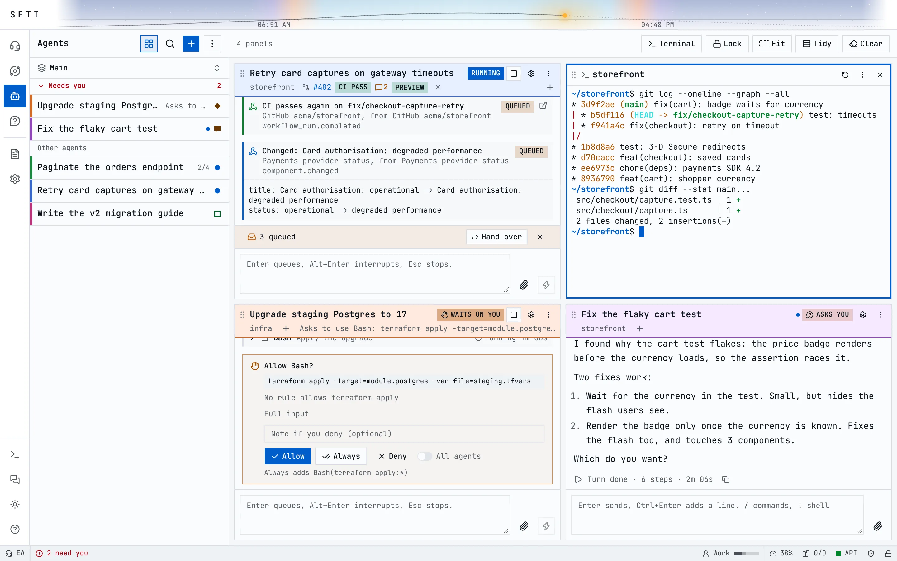
</picture>

## Highlights

**Answer from your phone.** Agents that wait on a permission or ask a question go to the top of
the list; you answer them, or ask the EA what needs you, in a tap.

<p align="center">
  <picture>
    <source media="(prefers-color-scheme: dark)" srcset="docs/screenshots/phone-agents-dark.webp">
    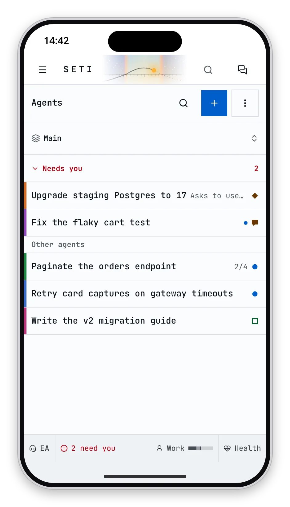
  </picture>
  <picture>
    <source media="(prefers-color-scheme: dark)" srcset="docs/screenshots/phone-permission-dark.webp">
    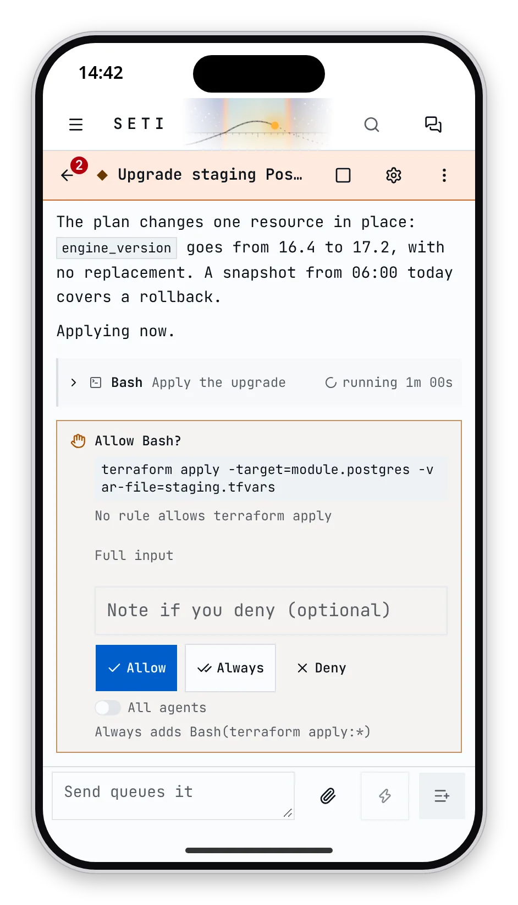
  </picture>
  <picture>
    <source media="(prefers-color-scheme: dark)" srcset="docs/screenshots/phone-ea-dark.webp">
    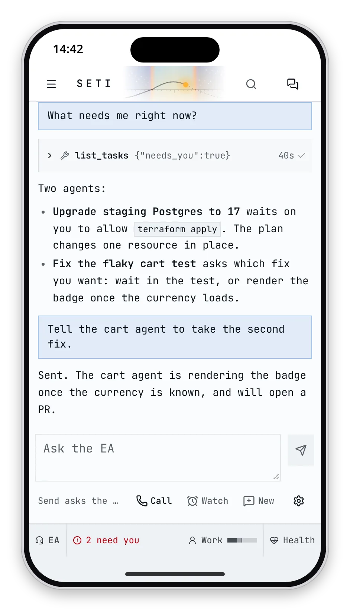
  </picture>
</p>

**See the whole team at once.** Seti opens on Home, a live graph of every agent in its colour,
linked to its repos, the MCP servers it calls and the subagents it runs, with the agents that need
you in a strip above it. Beside it: the merge streak, PRs merged this week and month, and turns,
time and cost per agent.

<picture>
  <source media="(prefers-color-scheme: dark)" srcset="docs/screenshots/home-dark.webp">
  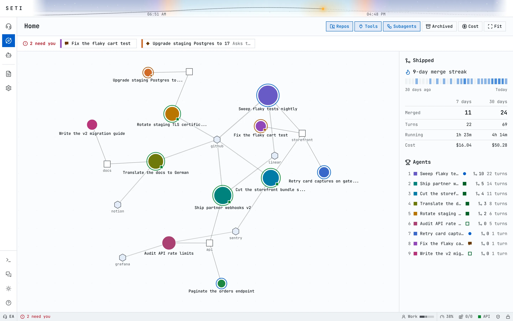
</picture>

**An assistant that knows what can wait.** The Executive Assistant (EA) takes voice and chat and
acts through Seti's own API. Every event goes to one place by its tier: what needs you reaches you
at once, on the live call, as a toast or as a phone push; routine news from agents the EA watches
waits; and when you come back, one since-you-left brief says what needs you and what changed.

**Channels: any service becomes an event source.** Signed webhooks, reminders and pollers feed
one stream; a poller turns a service without webhooks into events with a small script, a reminder
speaks up on an interval or a cron schedule, and each event can wake an agent or the EA.

<p>
  <picture>
    <source media="(prefers-color-scheme: dark)" srcset="docs/screenshots/channels-dark.webp">
    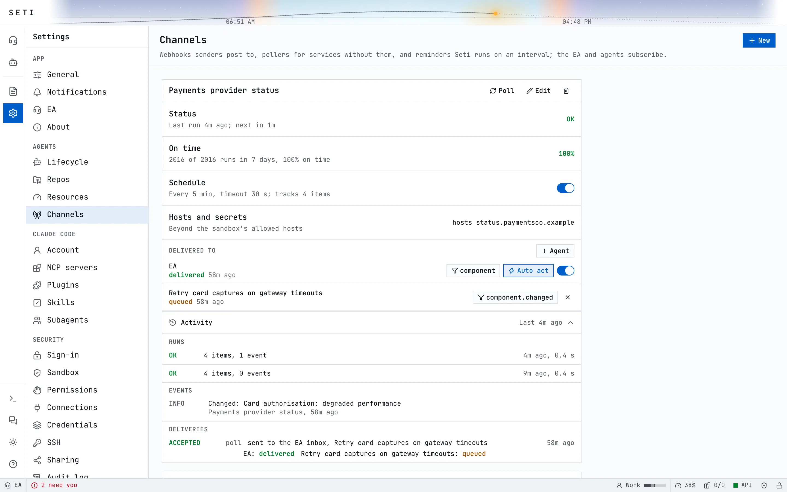
  </picture>
  <picture>
    <source media="(prefers-color-scheme: dark)" srcset="docs/screenshots/phone-channels-dark.webp">
    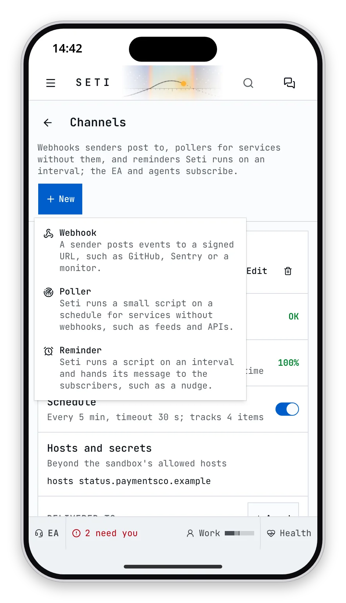
  </picture>
</p>

**Pull requests come back to the agent.** The PR an agent opens sits in its header with CI,
preview and review threads, and new reviews and failed checks reach the agent as input.

<picture>
  <source media="(prefers-color-scheme: dark)" srcset="docs/screenshots/pull-request-dark.webp">
  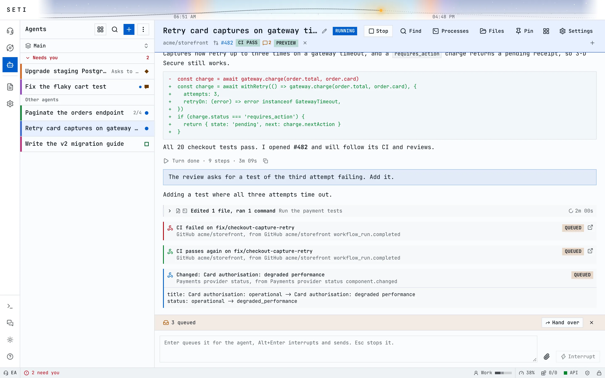
</picture>

**Files and share links.** Read and edit what an agent wrote, then share a frozen copy that
renders Markdown, PDFs, tables and code.

<p>
  <picture>
    <source media="(prefers-color-scheme: dark)" srcset="docs/screenshots/files-dark.webp">
    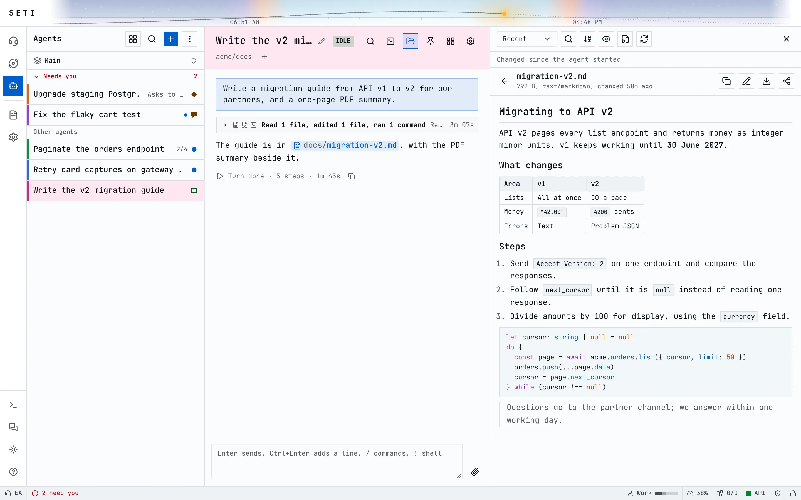
  </picture>
  <picture>
    <source media="(prefers-color-scheme: dark)" srcset="docs/screenshots/phone-share-dark.webp">
    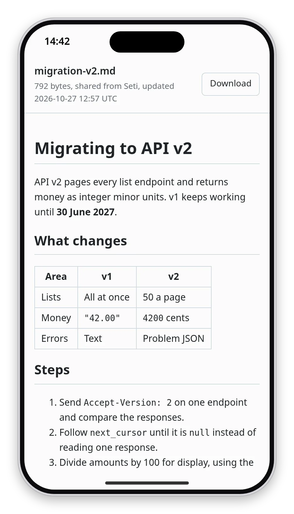
  </picture>
</p>

**Ask aside.** Type `/btw` and a question to ask an agent why it did something while it works:
the answer comes from its context in a side chat that never interrupts the turn or lands in its
transcript.

**One group chat.** You, the EA and every agent share one chat where an @mention reaches an agent
mid-turn. The EA and agents can also send one member a direct message, which only the two of them
and you see.

<picture>
  <source media="(prefers-color-scheme: dark)" srcset="docs/screenshots/group-chat-dark.webp">
  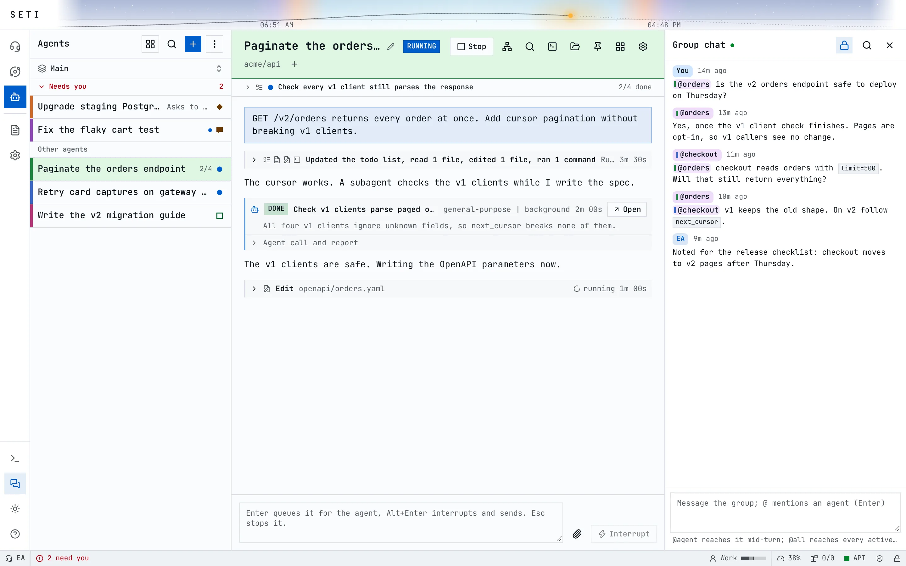
</picture>

**Restarts do not stop the work.** An upgrade or a reboot restarts Seti, and each agent it cut off
mid-turn picks up on its own, checking what finished before it carries on.

**Mods.** The Mods page in Settings turns mods on and off and shows what each one may reach. Seti
ships its own: the agent grid, side chat, file previews, Blobs (agents drawn as small faces),
weather, Vim mode, What's new, webhook sources and themes. Third-party mods install with Developer
mode on and run sandboxed with only the access you grant; [Mods](docs/mods.md) shows how to build
one.

<picture>
  <source media="(prefers-color-scheme: dark)" srcset="docs/screenshots/mods-dark.webp">
  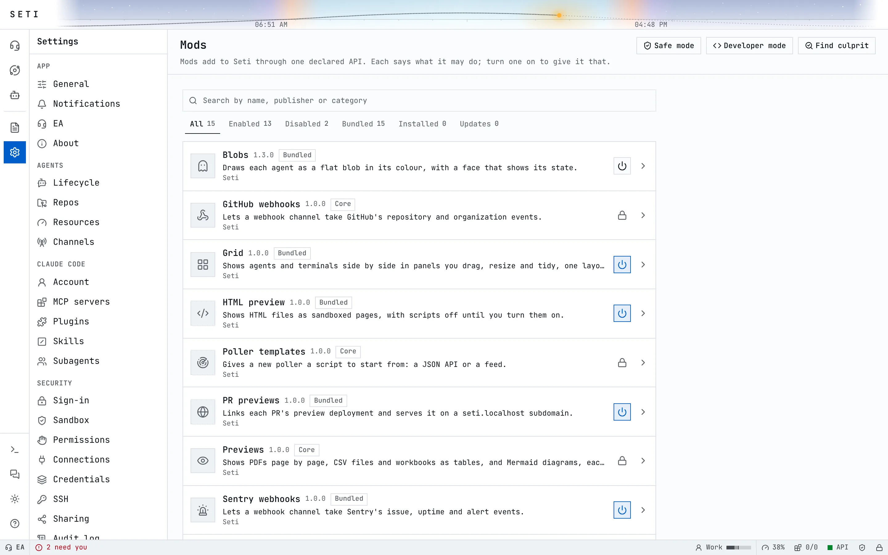
</picture>

## Security

Agents run code on your machine, so Seti treats every agent as untrusted.

- **Sandboxed.** Each agent runs in bubblewrap with its own PID and network namespaces, sees only
  its own directories, and reaches the network through a proxy that allows only listed hosts.
- **No keys inside.** Agents hold placeholders; the proxy adds GitHub tokens, AWS roles, the
  connections of the agent's credential and the Claude token on the way out, on allowed hosts only.
- **Guards that always hold.** A shell guard and your deny rules refuse `rm -r` outside the
  agent's folders, killing by name and writes to credential folders, even in Bypass, which is per
  agent, off by default and ends after 2, 8 or 24 hours.
- **Yours alone.** The EA and agents cannot change security settings or read secrets. An agent
  that needs an API key asks for it, and you paste the key on Allow; it goes to the secret store,
  never to the agent or its transcript.
- **Closed by default.** Seti listens on loopback, and every call needs a passkey, the local token
  or a Cloudflare Access login.
- **Shares are copies.** A share link serves a frozen copy from the database, with no script and
  no route to the file system.
- **Audited.** Every action lands in an audit log kept as a hash chain that Seti verifies.

<picture>
  <source media="(prefers-color-scheme: dark)" srcset="docs/screenshots/security-dark.webp">
  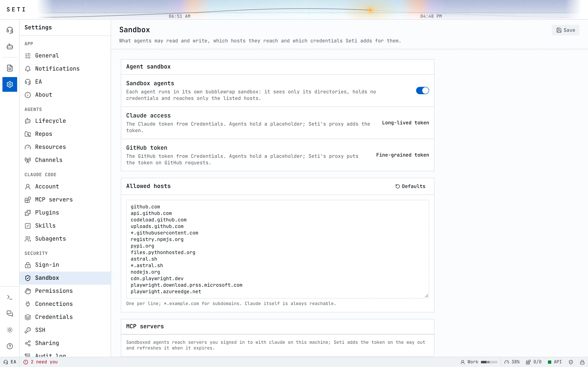
</picture>

[Security](docs/security.md) has the full model, where each secret lives, and rotation. To report a vulnerability, see [SECURITY.md](SECURITY.md).

## Quick start

Seti runs on Linux with systemd, with Ubuntu 24.04 as the reference. Start as a user with sudo,
not as root; a bare machine needs only `curl`. The installer asks before each step that needs sudo
and sets up the rest:

- git, build tools, Python 3, bubblewrap and socat for the agent sandbox, and `gh`, from apt;
- PostgreSQL 16 with a database role for your user;
- Node.js 24 through nvm, and pnpm through corepack;
- the Claude Code CLI in `~/.local/bin`;
- with `--with-redis`, Seti's own Redis cache (optional);
- with `--with-ea`, uv and the Executive Assistant (chat needs an OpenAI key, voice also Deepgram
  and ElevenLabs keys).

It then builds Seti and starts it as a systemd user service on `127.0.0.1:3006`.

```sh
curl -fsSL https://raw.githubusercontent.com/rickaym/seti/main/scripts/install.sh | bash -s -- --with-redis --with-ea
```

1. Open a new shell so `claude`, `node` and `pnpm` are on your `PATH`, then sign in to Claude Code
   (`claude`, then `/login`) and to GitHub (`gh auth login`).
2. Open `http://seti.localhost:3006`. From another machine, forward the port first:
   `ssh -L 3006:127.0.0.1:3006 <host>`.
3. Sign in with the token that `cat ~/.seti/credentials/local-token-user` prints.
4. Add a repo in Settings, Repos, then start an agent.

Leave out `--with-redis` and `--with-ea` for the smallest install. From a clone, run
`scripts/install.sh` with the same options. [Setup](docs/setup.md) covers every option, remote
access and upgrades, and `pnpm run doctor` in `~/seti` says what is wrong and how to fix it.

## Docs and contributing

[Setup](docs/setup.md), [Architecture](docs/architecture.md), [Security](docs/security.md),
[Pollers](docs/pollers.md) and [Mods](docs/mods.md) go deeper, and [iPhone and iPad](docs/ios.md) covers installing Seti on
the Home Screen. Issues and pull requests are welcome; [CONTRIBUTING.md](CONTRIBUTING.md) has the
checks and conventions.

## License

[Apache License 2.0](LICENSE). The UI shell is adapted from the Homer 11 UI; the favicon is the
[Full moon icon](https://www.flaticon.com/free-icon/full-moon_2204369) from Flaticon; the
[Catppuccin palette](https://github.com/catppuccin/palette) (MIT) and
[JetBrains Mono](https://www.jetbrains.com/lp/mono/) (SIL OFL 1.1) are used under their licenses. The
Twemoji mod draws emoji with [Twemoji](https://github.com/jdecked/twemoji) graphics, copyright
Twitter, Inc and other contributors, licensed under
[CC-BY 4.0](https://creativecommons.org/licenses/by/4.0/); `mods/twemoji/LICENSE` has the details.
